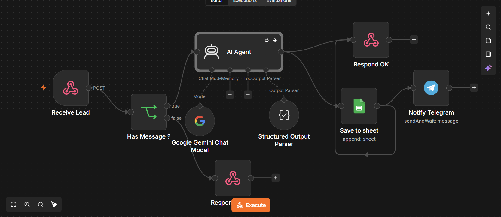

# AI Lead Qualifier (n8n)

A sample automation that scores and routes incoming sales leads using AI.
**Demo project with fake data. Not a production client system.**

Demo video: COMING SOON



## What it does
1. Receives a lead through a webhook (name, email, message)
2. Rejects submissions without a message (HTTP 400, nothing saved)
3. Uses Google Gemini to return structured JSON: summary, category,
   urgency, language, score (1-10) and a suggested next action
4. Saves the lead and the AI analysis to Google Sheets
5. Sends an instant Telegram alert to the business owner
6. Responds to the sender with a confirmation

## Tools
n8n, Google Gemini API, Google Sheets, Telegram Bot API

## Example
Input:
```json
{"name":"An","email":"an@example.com","message":"Need a chatbot for my store, budget 20M VND, want it done this week."}
```
AI output:
```json
{"summary":"Customer needs a store chatbot, 20M VND budget, this week.",
 "category":"pricing","urgency":"high","language":"English","score":10,
 "next_action":"Reply today with a quote and propose a call."}
```

## Error handling
- Missing message: 400 response, nothing saved
- Structured output parser keeps AI output as valid JSON
- AI_RETRY_LINE
- ERROR_WORKFLOW_LINE

## Setup
1. Import `lead-qualifier.json` into n8n
2. Create credentials: Google Gemini, Google Sheets, Telegram
3. Create a Sheet with columns: name, email, message, created_at, summary,
   category, urgency, language, score, next_action
4. Replace `YOUR_SHEET_ID` and `YOUR_CHAT_ID`
5. Publish the workflow and POST JSON to the production webhook URL

## Known limitations
- AI can misclassify; important leads should be reviewed by a human
- No duplicate-lead detection
- Email format is not validated

## Possible extensions
CRM integration, duplicate detection, human approval step, daily digest